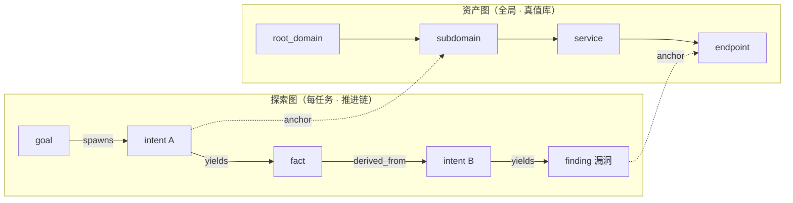
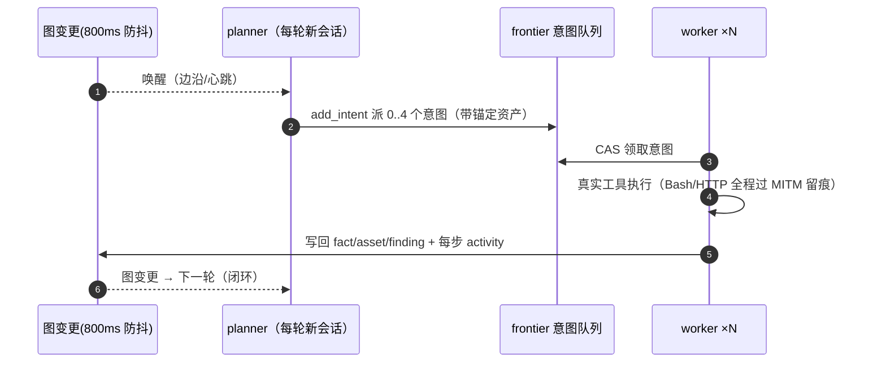
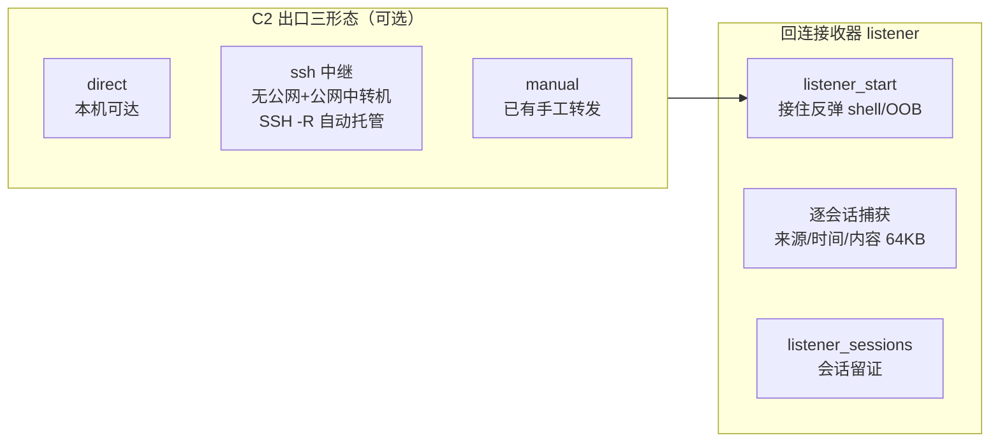

<div align="center">

# ARTEX

**AI 自主渗透测试 · 红队作战平台**

Go 单体后端（内嵌 Next.js 前端）· PostgreSQL · 多 Agent 自主推进 · 全程证据留痕

[](https://github.com/chu0119/ARTEX/releases)
[](https://github.com/chu0119/ARTEX/actions/workflows/ci.yml)
[](LICENSE)


📦 **Docker**：`ghcr.io/chu0119/artex` · `xingchuan1314/artex`
🧠 **单技能版**：[artex-skill](https://github.com/chu0119/artex-skill)——ARTEX 方法论的单 skill 版，任意 AI Agent 即装即用

</div>

---

## 这是什么

ARTEX 是一套 **LLM 多 Agent 自主渗透测试平台**：你给一句话目标，它自动完成
「目标拆解 → 侦察 → 漏洞挖掘 → 利用 → 后渗透 → 报告」全流程，人随时可以插手纠偏。

与本仓库**前一版本**（接手自已删除的原作者项目 `Autumn-27/ARTEX`，基于其最终定版
v0.3.15）相比，现在的 ARTEX 已经是**完全独立演进的新项目**——原作者的代码留在
git 历史里作为起点，v0.3.16 以来的 **160+ 提交、约 4 万行新增**全部由本仓库的
维护者完成，覆盖了原作者版本没有的整条能力线：

| 能力线 | 本版本做了什么 |
|---|---|
| **漏洞情报运营** | NVD / CISA KEV / GitHub Advisory / PoC 聚合 / nuclei 模板联动 / 资产指纹→CVE 反向匹配 / **近期高危快通道**（30 分钟一轮）——原作者版本完全没有情报层 |
| **红队作战** | TCP 回连接收器（接住反弹 shell 并留证）/ **C2 出口三形态**（direct / SSH 中继托管 / manual，**UI 管理页**：监听器启停/会话捕获可视化）/ redteam-ops 后渗透方法论 skill / 9 件后渗透工具（socat/proxychains/ligolo/linpeas/pspy/evil-winrm…） |
| **安全与合规** | 登录防爆破（IP 锁定+全局限流）/ 探活端点去指纹 / 改密码即吊销全部会话 / 安全响应头 / 认证面无产品名——**公网部署基线** |
| **工程可靠性** | LLM 三通道轮询（熔断+故障转移+用量归因）/ 拆解墙钟 / planner 双保险 / 任务收官 / 一键更新（校验+回滚） |
| **工具与交付** | 宿主工具 63 件**一键装齐** / 漏洞 19 类标准枚举 / **专业级 Word 报告**（封面·目录·页眉页脚·严重度着色·复测记录·流量证据·修复路线图）/ 证据版本化+sha256 校验 / 手机端适配 |
| **Agent 推理** | **意图假设与成功判据**（hypothesis/success_criteria）/ worker 五步作业框架+绕过清单 / stop_reason 进态势（接续归因不再靠猜）/ Guard 归因回流 planner / 续跑摘要与零写回复盘 / **按角色配模型**（模型路由策略文档化） |

原作者版本有的核心（双图架构、planner/worker 编排、MITM 流量代理、审批门）全部
保留并在其上加固；下文详述。

---

## 截图预览

| 仪表盘（总览 / Token 消耗 / 活动流） | 任务列表 |
| :---: | :---: |
|  |  |

| 任务 · 执行过程（会话 / 工具调用） | 探索链路 |
| :---: | :---: |
|  |  |

| 发现 | 资产 |
| :---: | :---: |
|  |  |

| 资产覆盖图（力导向布局 · 已测高亮） | 流量录制 |
| :---: | :---: |
|  |  |

| Agent 管理 | LLM 配置 | 拦截审批 | 后端日志 |
| :---: | :---: | :---: | :---: |
|  |  |  |  |

---

## 核心设计

### 双图架构：资产图 × 探索图

渗透测试的全部状态拆成两张独立、由锚点缝合的图：

- **资产图**（全局共享）：`root_domain / subdomain / ip / service / app / endpoint`
  六类节点的真值库，跨任务复用；公司归属 + 授权边界（task_scope）挂在这里。
- **探索图**（每任务一份）：`goal → intent → fact / finding` 的推进链，五种边
  （spawns / derived_from / yields / proves / covers）构成**血缘**——「这个发现
  是从哪条线索推出来的」全程可回溯，这是**报告可信度的根基**。



### 多 Agent 自主推进



- **planner** 是唯一意图生成者，持有一份跨唤醒共享的 todolist——串行利用链
  （注入点→凭据→横向）记录一次、按依赖逐步派发，不重复不错序。
- **worker** 做完一条意图即停；结果写回双图后自动唤醒 planner。
- **空转收场 / 拆解墙钟 / 规划轮超时 / model_error 重跑** 多层韧性：免费限流
  通道也能稳定跑完任务（三通道轮询 + 故障转移 + 熔断实测）。
- **人在环路**：对话纠偏 / 意图暂停取消 / 人工审批 / `steer_work` 实时纠偏，
  每步 activity 在 UI 内联可见。

### 漏洞情报运营（持续，不是静态知识库）

多数同类产品的情报是「按组件查」；ARTEX 做的是「**按时间流**」——
**最近 7 天爆了什么 → 匹配我的资产 → 排进任务**：

- NVD 全量/增量 + **CISA KEV 在野利用** + **GitHub Advisory**（版本区间第二来源）
  + GitHub PoC 聚合
- **近期高危快通道**：按发布时间每 30 分钟拉 CVSS≥9.0 或 KEV，几十分钟进库
- **资产指纹→CVE 反向匹配**：同步的 CVE 自动匹配资产 technologies 指纹，
  命中即向任务挂 hint
- **版本区间精确判定**：`search_vulns` 返回 `version_in_range` 三态；
  NVD 不填区间时 GHSA 补（保守判定：解析不出→「可能受影响」）

### 红队作战能力



- **回连接收器**：接住反弹 shell / OOB 回连，逐会话记录来源、时间、捕获内容；
  REST + agent 工具双入口；启停走人工审批（ask）。
- **C2 出口配置**：本机有公网→direct；无公网+公网中转机→SSH 反向隧道平台托管
  （断线自动重连）；已有转发→manual。`listener_start` 返回解析后的回连地址，
  agent 直接填 payload，无需自行判断网络形态。
- **redteam-ops skill**：后渗透六阶段方法论（落地稳定化→提权→权限保持→凭据
  获取→横向移动→数据获取回传→收尾）+ 证据纪律。
- **后渗透工具（含 9 件红队补齐）**：impacket/netexec/evil-winrm/chisel/ligolo-ng/proxychains/
  socat/linpeas/pspy/responder/sqlmap/hydra/hashcat/nuclei/ffuf…全部可在
  「宿主环境」页**一键装齐**（特权助手 artex-hostd 串行排队执行）。

### 审批与拦截：三层闸门

| 层 | 语义 | 内置规则 |
|---|---|---|
| 明令禁止 `deny` | 任何语境都不可逆且无合法渗透用途——不调模型直接拒 | 10 条 |
| 交 Agent 研判 `judge` | 作用对象取决于上下文（删测试表 vs 删生产表）——命中后走模型裁决 | 12 条 |
| 人工确认 `ask` | 平台能力边界变更（如开监听端口）——转人工审批 | 1 条 |

- 规则级 timeout 真生效（研判类 90s/allow，硬禁类 30s/deny）；
- 模型裁决**严格 JSON 解析**（解析失败走失败策略，绝不猜）；
- 拦截原因带「平台管控」框架——防止 agent 把平台策略当目标防御来绕；
- 反注入边界：裁判输入刻意收窄（仅工具名+参数+工作目录），历史不进裁判视野。

### 全程证据链

- **MITM 记录代理**：worker 的全部 HTTP/S 流量逐请求留存（CA 签发留痕）；
- **发现绑定流量**：finding 可绑定 baseline/proof/verification/supporting 四类
  流量证据，快照版本化（sha256），报告引用可验证；
- **数据回传**：本机文件内容外传类命令有专属拦截规则（judge 研判）；
- **报告导出**：Word（OOXML 手写零依赖）按 19 类漏洞枚举折叠聚合；
- **对抗式自检**：换身份/换参数顺序/换客户端复现——「确认了才报」。

---

## 安装

> 依赖 **PostgreSQL**；探索需配置 **LLM**（UI 里配，支持 Anthropic / OpenAI /
> 任意 OpenAI 兼容网关，三通道轮询 + 故障转移）。

### 方式一：一键部署脚本（推荐）

```bash
git clone https://github.com/chu0119/ARTEX.git && cd ARTEX
sudo ./install.sh                    # 交互选择（默认二进制）
sudo ./install.sh --mode=binary      # 二进制 + systemd（生产推荐）
sudo ./install.sh --mode=binary --with-tools   # 顺装常用渗透工具
sudo ./install.sh --mode=docker      # Docker Compose
```

幂等：重复执行 = 原地升级；`config.json` / `jwt.key` / 数据 / 数据库不动。
卸载：`systemctl disable --now artex artex-hostd && rm -rf /opt/artex`。

### 方式二：下载预编译二进制

到 [Releases](https://github.com/chu0119/ARTEX/releases) 下载对应平台 zip
（5 平台 + SHA256SUMS），解压后：

```bash
cp config.example.json config.json   # 填好 database 连接
./start.sh                           # → http://localhost:8787
```

> 用 `start.sh` 启动而非直接跑二进制——它是守护脚本，「一键更新」靠它完成换装。

### 方式三：从源码编译

```bash
cd web && npm ci && npm run build:static && cd ..
cp -r web/out server/webui/dist
CGO_ENABLED=0 go build -tags embedui -o artex ./cmd/artex
CGO_ENABLED=0 go build -o artex-hostd ./cmd/artex-hostd   # 可选：特权安装助手
./start.sh
```

### 首次启动

1. 浏览器打开 `http://<host>:8787` → 初始化管理员密码（≥8 位）
2. 「LLM 配置」页配模型通道（≥2 个通道 + 开启轮询 = 实战推荐）
3. 「宿主环境」页一键装齐缺失工具（或 `install.sh --with-tools`）
4. 新建任务，给一句话目标

### 公网部署

v0.3.85 起内置公网部署安全基线（登录防爆破、探活去指纹、改密吊销会话、
认证面无产品名）。必须：HTTPS 反代 + 覆写 `X-Forwarded-For`。
完整基线见 [docs/公网部署安全加固-2026-10-29.md](docs/公网部署安全加固-2026-10-29.md)。

### 升级

**页面一键更新**（系统配置 → 版本与更新）：下载 → SHA256 校验 → 冒烟测试 →
原子换装 → 失败自动回滚到上一版。升级只换程序不动数据，schema 幂等迁移。

---

## 配置速查

**数据库**（`config.json` 或 `ARTEX_PG_DSN`）：

```json
{ "database": { "host": "127.0.0.1", "port": 5432, "user": "artex",
                "password": "…", "dbname": "artex", "sslmode": "disable" } }
```

**LLM**：环境变量 `ANTHROPIC_API_KEY` / `OPENAI_API_KEY` 可兜底，UI「LLM 配置」页
配多通道 + 开启「LLM 轮询」。常用参数：`./start.sh -addr :8787 -proxy :8788`。

**C2 出口**（可选）：`PUT /api/c2/config` 配 `mode=direct|ssh|manual` +
中转机地址/SSH 凭据——`listener_start` 自动返回解析后的回连地址。

---

## 反向代理（HTTPS）

前端和 API/SSE 同源，反代必须关缓冲。Nginx 示例：

```nginx
server {
    listen 443 ssl;
    server_name your.domain.com;
    location / {
        proxy_pass http://127.0.0.1:8787;
        proxy_set_header Host $host;
        proxy_set_header X-Forwarded-Proto $scheme;
        proxy_set_header X-Forwarded-For $proxy_add_x_forwarded_for;  # 限流依赖
        proxy_buffering off; proxy_read_timeout 3600s;               # SSE 必需
        proxy_http_version 1.1; proxy_set_header Connection "";
    }
}
```

---

## 开发

```bash
./dev.sh    # 后端(:8787) + 流量代理(:8788) + 前端 next dev(:5173)
go test ./...   # 连 PG 跑全量（CI 用 -p 1 串行防跨包死锁）
cd web && npx tsc --noEmit && NEXT_EXPORT=1 npx next build
```

- 后端：`go run ./cmd/artex`（`-tags embedui` 内嵌前端）
- 前端：`cd web && npm run dev`（`/api` 反代热更新）
- Mock 预览：`cd web && NEXT_PUBLIC_MOCK=1 npm run dev`

---

## 项目结构

```
cmd/            程序入口（artex 主服务 / artex-hostd 特权助手）
agent/          多 Agent 层：planner / worker / mainagent / 领域工具（tools_*.go）
db/             PostgreSQL 唯一存储：schema.sql（幂等迁移）+ 全部表 Store
server/         HTTP 服务：路由 / 引擎调度 / Manager / 会话 / 报告 / 更新
intercept/      拦截引擎：规则匹配 → LLM 研判 → allow/ask/deny
guard/          工具调用审批门（把裁决接进 agent 执行链）
listener/       回连接收器：接住反弹 shell / OOB 回连并留证
traffic/        MITM 流量记录代理 + 出口代理池
vulnintel/      漏洞情报：NVD/KEV/GHSA/PoC/快通道/资产联动/限速闸门
hosttools/      宿主工具目录（54+ 件，按攻击面分类）
hostd/          特权助手：root 常驻 unix socket，装工具/特权操作
llmpool/        LLM 多通道轮询池：熔断/故障转移
llmrec/         LLM 请求录制与 token 计量
report/         报告生成：Word 导出（手写 OOXML 零依赖）
notify/         通知推送：钉钉/飞书/企业微信等
evidence/       发现的证据留存与版本化
enrich/         资产自动补全：DNS / HTTP 探测
selfupdate/     一键自更新：查 Release → 校验 → 换装
skills/         内置 skill：vuln-hunting / redteam-ops / api-recon / …
web/            Next.js 前端（静态导出后 go:embed 内嵌）
docs/           设计文档 / 部署手册 / 评估报告 / 能力对照
```

## 文档索引

| 文档 | 内容 |
|---|---|
| [docs/01-双图架构.md](docs/01-双图架构.md) | 资产图/探索图、锚点、schema 迁移设计、不变量清单 |
| [docs/02-引擎与调度闭环.md](docs/02-引擎与调度闭环.md) | planner/worker 编排与生命周期 |
| [docs/03-LLM接入层.md](docs/03-LLM接入层.md) | 通道选路、轮询池、熔断、录制计量 |
| [docs/04-审批与拦截.md](docs/04-审批与拦截.md) | 三层规则与裁决链路、反注入边界 |
| [docs/部署手册.md](docs/部署手册.md) | 部署 / 升级 / 排障（实测踩坑全记录） |
| [docs/公网部署安全加固-2026-10-29.md](docs/公网部署安全加固-2026-10-29.md) | 公网部署安全基线 |
| [docs/红队能力建设-2026-10-30.md](docs/红队能力建设-2026-10-30.md) | 杀伤链能力矩阵 / 竞品对照 / 路线图 |
| [docs/漏洞挖掘能力对比.md](docs/漏洞挖掘能力对比.md) | 与开源同类逐项对比、M 清单 |
| [docs/产品优化清单-2026-10-29.md](docs/产品优化清单-2026-10-29.md) | 优化/新增/删除路线图（历史快照） |
| [docs/产品全面体检-2026-10-31.md](docs/产品全面体检-2026-10-31.md) | 四路全面体检：P0 缺陷基线/冗余清单/执行批次状态 |
| [docs/深度优化方案-2026-10-31.md](docs/深度优化方案-2026-10-31.md) | 报告质感×Agent 认知×攻击链——当前路线图 |
| [docs/模型路由策略.md](docs/模型路由策略.md) | 按角色配模型：planner 强推理/worker 中推理/judge 便宜档 |

## 与原作者版本的关系（来源声明）

原作者 [Autumn-27/ARTEX](https://github.com/Autumn-27/ARTEX)（百度“Agent+”攻防
挑战赛冠军项目）于 2026-10 删除了仓库，原链接 / Release / Docker 源全部失效。
本仓库在其**最终定版 v0.3.15**（git 历史 462 提交完整保留）基础上接手维护：

- **保留**：双图架构、planner/worker 编排、MITM 流量代理、审批门框架、基础
  工具集——原作者的架构设计是优秀的，git 历史向其致意；
- **重建**：全部设计文档（原作者删除过 docs）、CI 门禁、依赖解耦（norma SDK
  fork）、Docker 源；
- **新增**：上文[能力线](#这是什么)所列的情报运营 / 红队作战 / 安全加固 /
  工程可靠性 / 工具与交付五大线，以及 160+ 提交的持续修复与加固。

换言之：**起点是别人的，现在是我们的。**

---

## 许可与免责声明

### 开源协议

**AGPL-3.0**——衍生作品（含网络服务）须同样开源。完整条款见 [LICENSE](LICENSE)。

### 使用限制

**本工具仅供个人学习、代码研究与本地技术验证使用，不得用于对任何线上系统或
网站发起实际测试。** 允许范围：阅读学习源码、本地隔离环境验证。严禁：对任何
线上系统发起扫描/探测/利用（无论是否授权）、实际渗透对抗、生产环境使用、
非法入侵与数据窃取。

使用者须自行遵守所在国家/地区全部法律法规（含《网络安全法》《数据安全法》
《个人信息保护法》等）。**因使用本工具产生的一切法律责任由使用者自行承担。**

本项目按“现状”提供，不附带任何担保。下载、安装或使用即表示已阅读并同意
上述全部条款。

---

## 交流

扫码关注微信公众号 **SecSentry**，后台私信入群。

<div align="center">

</div>

## 参考

- [norma](https://github.com/Autumn-27/norma) — agent harness SDK（本平台多 Agent 引擎）
- [Cairn](https://github.com/oritera/Cairn) — 黑板架构参考
- [SecLists](https://github.com/danielmiessler/SecLists) / [nuclei-templates](https://github.com/projectdiscovery/nuclei-templates) — 语料与模板
